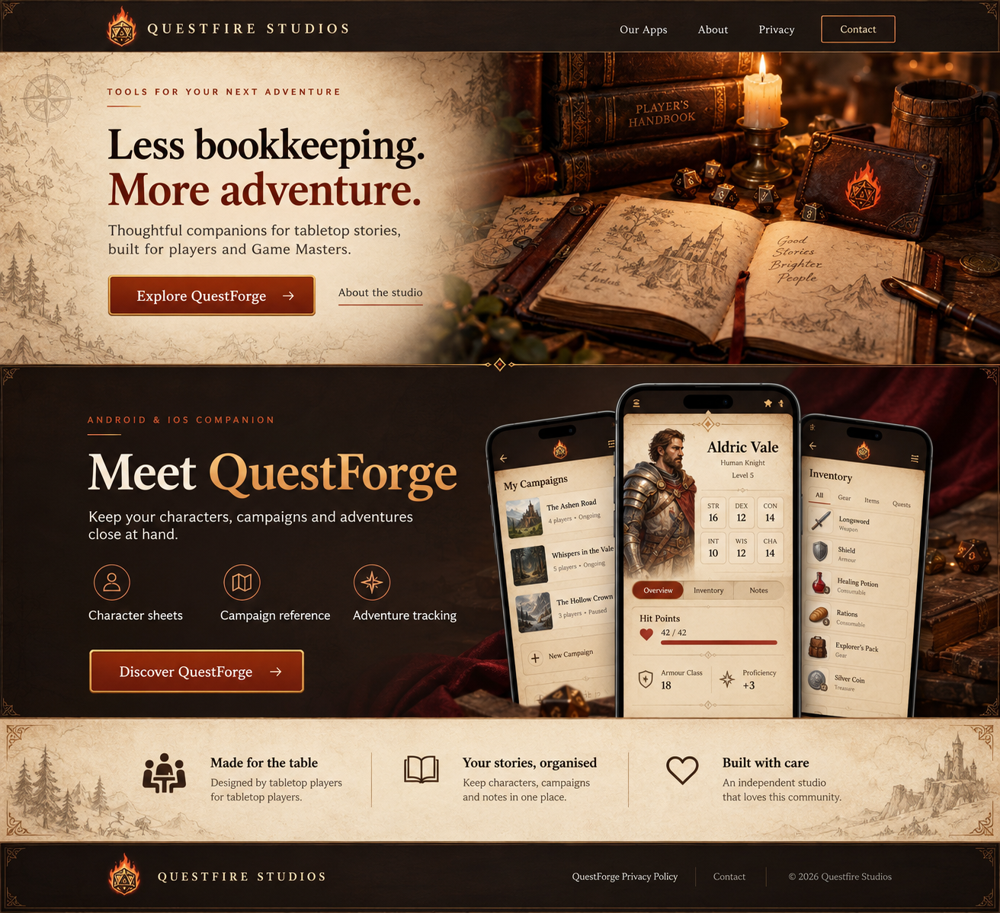

# Questfire Studios website concept

This is a visual reference for Cursor, not an implemented website.

Design: parchment, dark leather/walnut, brass borders, ember orange accents, readable serif headings and sans-serif body text. Feature QuestForge with a clear public privacy-policy link. Keep artwork separate from live HTML text. On phones, stack the hero and product sections.

Suggested implementation: React + TypeScript, reusable components and CSS variables, deployed to Cloudflare Pages. Pages: Home, QuestForge, About, Privacy (/privacy). Replace conceptual phone screens with real QuestForge screenshots and review copy before publishing. The illustrated logo is a concept, not an existing official mark.

For the full React implementation instructions, see [CURSOR_IMPLEMENTATION.md](CURSOR_IMPLEMENTATION.md).
